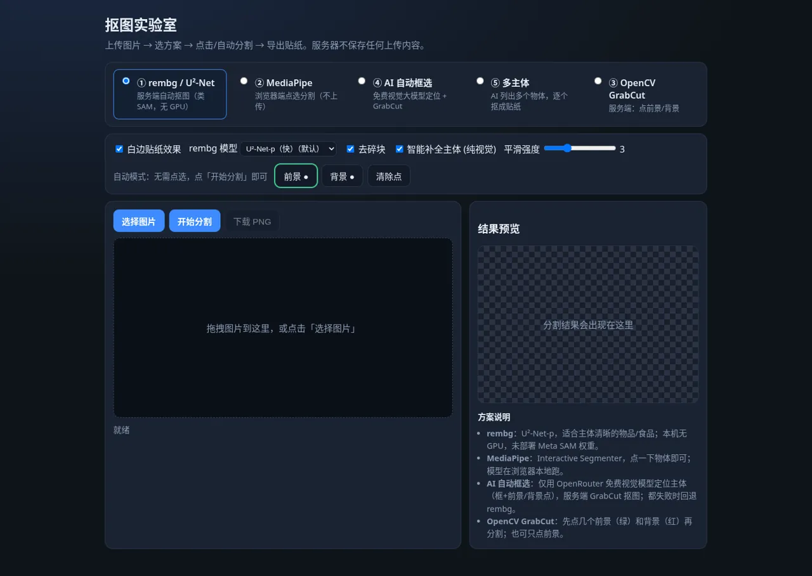
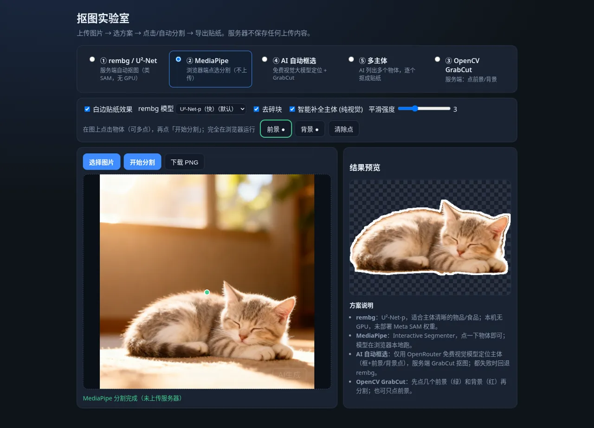
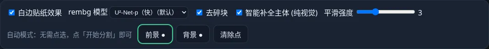

# segImage · 抠图实验室

拍照/上传图片 → 自动或点选分割 → 输出带白边的贴纸 PNG。线上示例：`https://jev.fishmaple.cn/segImage/`

## 功能

- **白边贴纸**：透明背景 + 可选白色描边，自动裁剪到主体
- **掩码后处理**：开/闭运算去噪点、保留主要连通块、填洞、轮廓平滑、边缘羽化、导向滤波（「平滑强度」滑块，0=关闭；「去碎块」开关）
- **智能补全主体（纯视觉）**：以模型掩码为种子，用图像边缘的背景颜色模型 + 边缘连通洪泛 + 凸包/外轮廓填充构造 trimap，再用 GrabCut 生长到完整主体，可选 SLIC 超像素投票；带防“吞背景”保护。可选的盘/碗椭圆检测只作辅助线索
- **不保存数据**：上传只在内存中处理，请求结束即丢弃；无数据库、不落盘（systemd `PrivateTmp=true`）

## rembg 模型选择

界面「rembg 模型」下拉框 / API 参数 `rembg_model`。模型按需加载，内存中最多同时保留 2 个（LRU 淘汰）。

在 4 vCPU / 3.6 GB 无 GPU 服务器上的实测（单张约 1280px）：

| 模型 | 推理耗时 | 峰值内存 | 备注 |
|---|---|---|---|
| u2netp（默认） | ~0.3 s | ~0.7 GB | 最快，物品类结果最干净 |
| silueta | ~0.7 s | ~0.75 GB | 截图类背景易漏抠 |
| u2net | ~0.7 s | ~1.2 GB | 与 silueta 接近 |
| isnet-general-use | ~1.8 s | ~1.9 GB | 碗沿保留更多，但截图类物体丢失，未设为默认 |
| birefnet-general-lite | — | >2.9 GB（OOM） | 未启用：权重已就位且 md5 校验通过，但在 2.6 GB 和 2.9 GB 内存上限下（关闭 ORT 内存池后仍然）均在第一张图推理时 OOM，3.6 GB 机器无法与服务共存 |

## 分割模式

| 模式 | 运行位置 | 说明 |
|---|---|---|
| ① rembg / U²-Net-p | 服务端 | 自动抠图（类 SAM 的替代方案；无 GPU 时不部署 Meta SAM） |
| ② MediaPipe Interactive Segmenter | 浏览器 | 点一下物体即可，模型从 CDN 加载，图片不上传 |
| ③ OpenCV GrabCut | 服务端 | 点前景（绿）/背景（红）点 |
| ④ AI 自动框选 | 服务端 | 免费视觉大模型给出主体框 + 前景/背景点 → GrabCut；可一键用这些点自动跑 MediaPipe |
| ⑤ 多主体 | 服务端 | 免费视觉大模型列出最多 6 个物体，逐个 GrabCut + 贴纸；画廊单张下载 / 全部下载（JSZip） |

### OpenRouter 只用免费模型（硬规则）

- 运行时请求 `https://openrouter.ai/api/v1/models`，**只保留 id 以 `:free` 结尾且支持图片输入**的模型（排除 safety/guard 类）
- 优先级：Qwen VL → Gemini → Llama Vision → Gemma → Nemotron Omni → 其它
- 出错 / 限流 / JSON 不合法就换下一个免费模型；返回 403 的模型缓存跳过 6 小时
- **绝不调用付费模型**；全部失败时回退本地 rembg（多主体模式回退为 rembg 连通块拆分，标签「主体N」）
- API Key 只放在服务器的 root-only 环境文件中，**不会出现在前端**

## 界面截图

| 初始状态（桌面） | rembg 自动抠图 |
|---|---|
|  |  |
| **AI 自动框选**（虚线框 + 前景绿点/背景红点，显示所用免费模型） | **多主体**（原图标注 + 贴纸画廊 + 全部下载） |
|  |  |
| **MediaPipe 点选**（浏览器本地推理，不上传） | **设置栏** |
|  |  |

移动端（390px 宽）：

<p>


</p>

## 案例对比

以下结果均通过线上 API 实测（4 vCPU、无 GPU；平滑 3、去碎块、白边；输入长边 ≤1280px）。MediaPipe 在无头 Chrome 中模拟一次点击得到。耗时为端到端请求时间，含排队与免费模型调用；AI/多主体的耗时主要取决于免费模型的限流情况。金色边框为该案例的最佳结果。

### 案例 1 · 书封实拍


- **最佳：rembg U²-Net-p**，干净地拿到整本书的矩形轮廓，约 8 s。U²-Net / Silueta / AI 自动框选结果接近。
- ISNet 把“书”理解成封面上的文字，只留下几个字，失败；MediaPipe 单点在白色封面上无法越过黑色腰封，下半部分破碎。
- GrabCut 矩形初始化把书的上半部分抠得很好，但丢了腰封；多主体模式里免费模型全部失败，回退到 rembg 连通块，结果等同于 rembg。
- 结论：主体是“平面物体 + 大块文字”时，显著性模型（U²-Net 系列）比通用分割更可靠。

### 案例 2 · 逆光小猫


- **最佳：U²-Net（完整）+ 智能补全**，毛发边缘和前爪最完整。ISNet、Silueta、MediaPipe 单点也都可用，MediaPipe 只需 4 s 且不上传图片，但输出分辨率受页面画布限制。
- 失败模式：U²-Net-p + 智能补全在左侧误补了一条地毯；GrabCut 用固定矩形初始化时把明亮的窗户也当成前景。AI 自动框选识别为“猫咪”，框准确，GrabCut 细节略逊于显著性模型。
- 结论：主体清晰的单物体，优先 rembg（U²-Net / ISNet）；需要隐私或离线时用 MediaPipe。

### 案例 3 · 全息汉服人像（复杂发光背景）


- **最佳：U²-Net（完整）+ 智能补全**，人物与大部分半透明纱袖保留得最干净；Silueta 接近。
- 这是最难的一类：半透明全息面料与发光背景颜色相近。U²-Net-p + 智能补全把大片背景当成主体“补全”进来（智能补全的已知失败模式：背景与主体颜色相近时）；ISNet 和 GrabCut 带入了较多光线背景；MediaPipe 单点只拿到身体，纱袖丢失。
- 多主体被免费模型拆成“女/裙”两个重叠物体，按重叠消解后成了碎片，不适合此类图。
- 结论：复杂背景下用更大的 U²-Net / Silueta，并考虑关闭智能补全对比一下。

## 方案选择指南

| 场景 | 推荐方案 | 备注 |
|---|---|---|
| 主体清晰的单个物品 / 食物 / 宠物 | rembg U²-Net-p（默认）+ 智能补全 | 最快（模型推理约 0.3 s）；不满意时换 U²-Net 或 ISNet |
| 盘子 / 碗里的整份菜 | rembg U²-Net-p + 智能补全 | 智能补全会利用碗沿椭圆把容器一起抠出 |
| 复杂或发光背景、半透明材质 | rembg U²-Net（完整）或 Silueta | 若出现背景被“补全”，关闭智能补全 |
| 平面物体（书、卡片、包装） | rembg U²-Net-p / U²-Net | 避免 ISNet（容易只留下文字） |
| 想精确指定抠哪一个 | MediaPipe 点选 或 OpenCV GrabCut 点前景/背景 | MediaPipe 完全在浏览器运行 |
| 不知道主体在哪 / 截图类 | AI 自动框选 | 只用免费模型，常被限流；失败自动回退 rembg |
| 一张图里有多个物品要分别做贴纸 | 多主体 | 物体分开摆放时效果好；重叠物体容易被拆碎 |

## 目录

```
backend/      FastAPI 服务（app/main.py 等）、requirements.txt
frontend/     静态页面 index.html / app.js / style.css
deploy/       systemd 单元、nginx location 片段
.env.example  环境变量示例
```

## 部署（Debian + nginx）

```bash
# 1. 后端
mkdir -p /opt/segImage && cp -r backend/* /opt/segImage/
cd /opt/segImage && python3 -m venv venv && venv/bin/pip install -r requirements.txt

# 2. 模型缓存（rembg 首次会自动下载 u2netp.onnx；国内可预先放到此目录）
mkdir -p /var/cache/segImage/u2net && chown -R www-data:www-data /var/cache/segImage /opt/segImage

# 3. 密钥（root only）
mkdir -p /etc/segImage && cp .env.example /etc/segImage/env   # 填入真实 key
chmod 600 /etc/segImage/env && chown root:root /etc/segImage/env

# 4. systemd
cp deploy/segImage.service /etc/systemd/system/
systemctl daemon-reload && systemctl enable --now segImage

# 5. 前端 + nginx
mkdir -p /var/www/jev/segImage && cp frontend/* /var/www/jev/segImage/
# 把 deploy/nginx-segImage.conf 的内容放进站点 server { } 块（/segImage/api/ 需在 ^~ /segImage/ 之前）
nginx -t && systemctl reload nginx
```

健康检查：`curl https://<域名>/segImage/api/health`

## 已知限制

- 无 GPU 机器上只用 rembg U²-Net-p（轻量），复杂场景可能只抠出部分主体；「智能补全」能补回与背景颜色差异明显的部分，但与背景颜色相近的部分（如深色食物对深色桌面）仍可能缺失
- 免费模型经常限流（429），AI 模式可能回退到 rembg
- 画面被单一纹理铺满（如满屏叶子）时 rembg 无法给出种子，补全也无效
