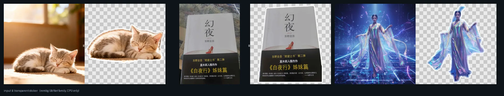
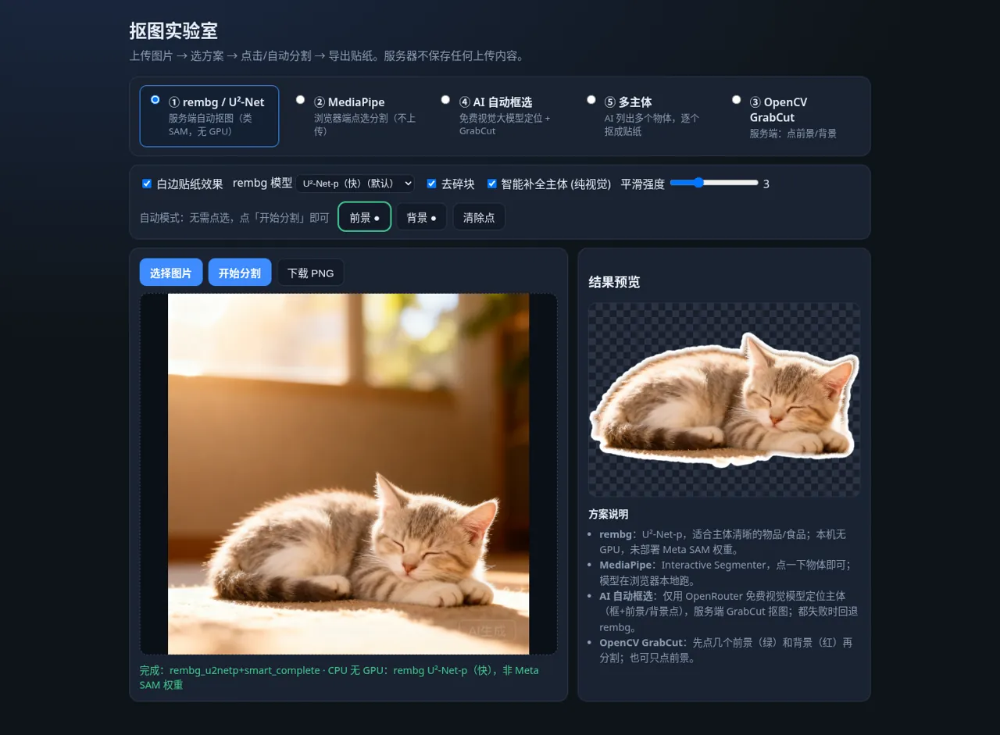
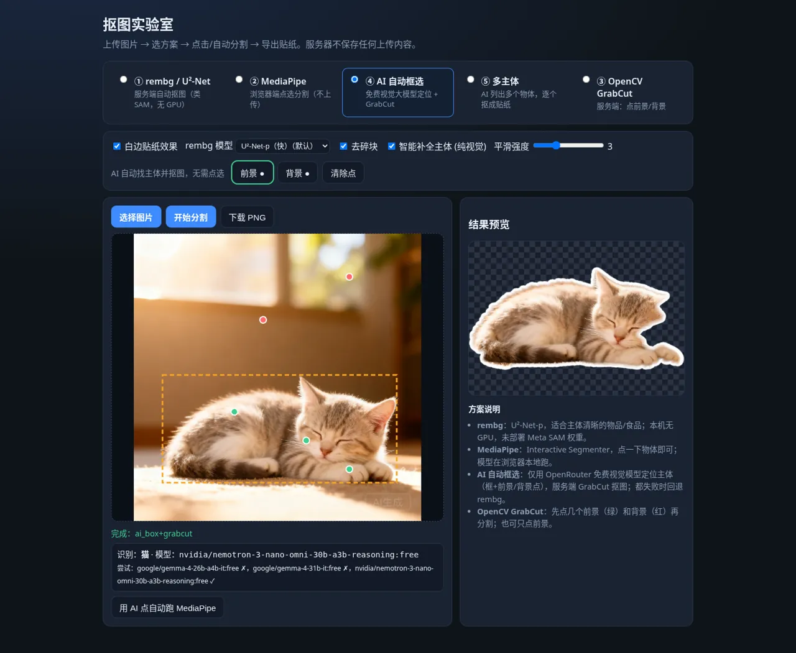
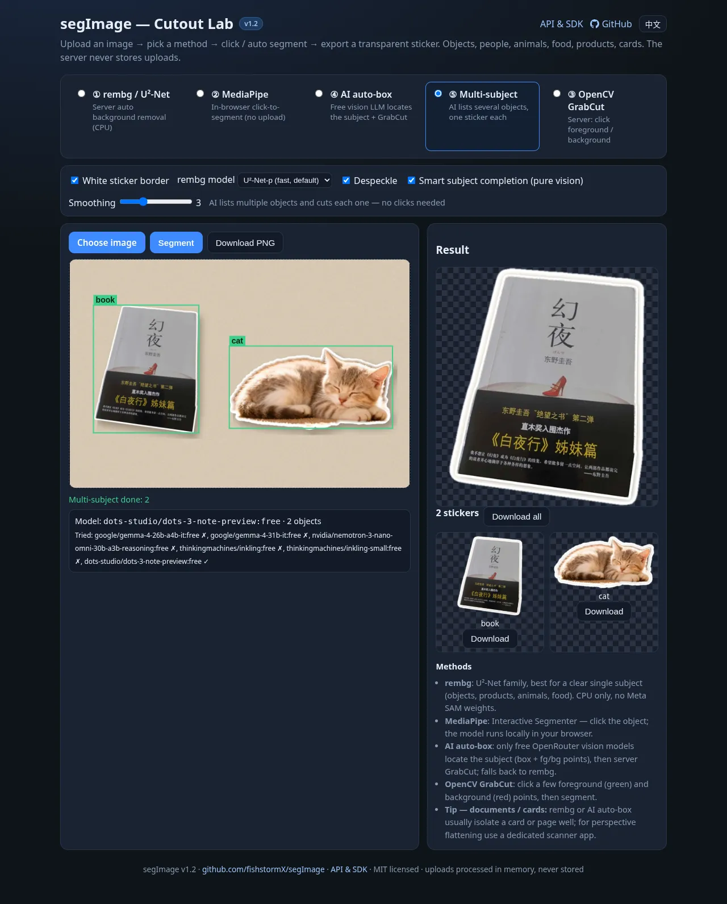
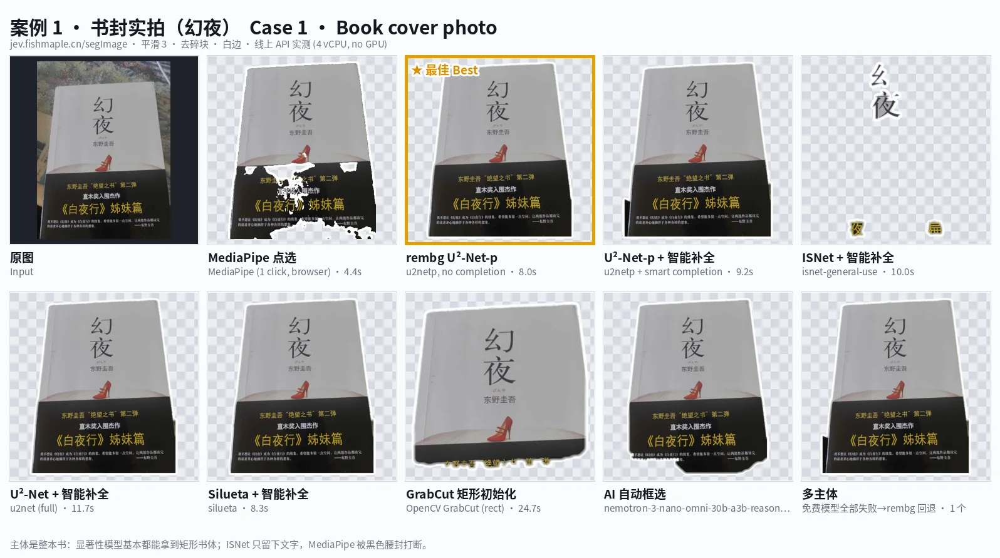
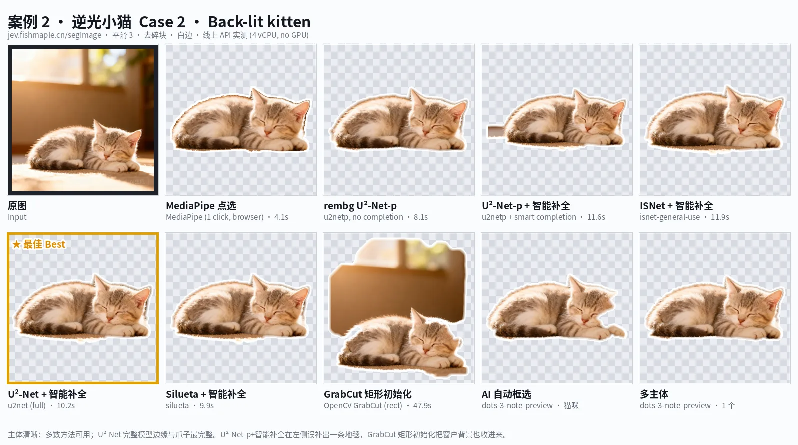
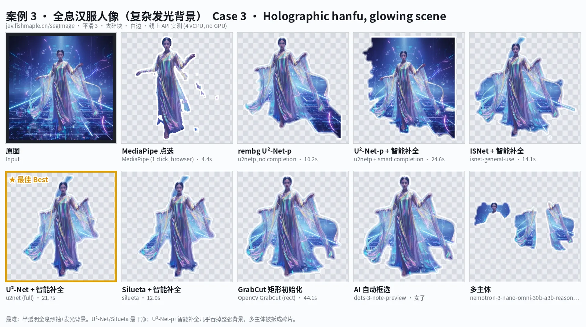

<div align="center">

**English** · [简体中文](README.zh-CN.md)

# ✂️ segImage

**Open-source background removal & sticker cutout — rembg, MediaPipe, OpenCV GrabCut and free AI auto-box, with a REST API, SDKs and a privacy-first web demo that never stores your uploads.**

[](CHANGELOG.md)
[](LICENSE)
[](backend/requirements.txt)
[](https://fastapi.tiangolo.com/)
[](https://jev.fishmaple.cn/segImage/)



</div>

## Features

- **5 segmentation methods in one UI** — rembg (U²-Net family, server CPU), MediaPipe Interactive Segmenter (in-browser, nothing uploaded), OpenCV GrabCut (click foreground/background), **AI auto-box** (a free vision LLM finds the subject → GrabCut) and **multi-subject** (one sticker per object, ZIP download).
- **Works on any subject** — objects & products, people, animals, food, books, cards and documents.
- **Sticker output** — transparent PNG, auto-cropped, optional white outline.
- **Mask post-processing** — despeckle, hole filling, contour smoothing, guided-filter feathering (`smooth` 0–10).
- **Smart subject completion (pure vision)** — grows a partial model mask to the whole subject using a border colour model, flood fill, trimap + GrabCut and SLIC voting, with a guard against swallowing background.
- **Versioned REST API** (`/api/v1/*`) with OpenAPI / Swagger docs, consistent JSON errors, and thin **Python** and **JS/TS** SDKs.
- **Free models only** — the AI modes use only OpenRouter models whose id ends in `:free`; without a key (or when all fail) they fall back to local rembg.
- **Privacy** — uploads are processed in memory and discarded; no database, nothing written to disk.
- **Bilingual UI** — English / 中文 (`?lang=zh`, remembered in your browser).

## Live Demo

👉 **https://jev.fishmaple.cn/segImage/** · API docs: [in-site guide](https://jev.fishmaple.cn/segImage/api.html) · [Swagger UI](https://jev.fishmaple.cn/segImage/api/docs)

The demo runs on a small 4-vCPU box without a GPU — please be gentle, and self-host for batch work.

| Desktop | AI auto-box | Multi-subject |
|---|---|---|
|  |  |  |

## Quickstart

Requires Python 3.10+ (tested with 3.13). The first request downloads the `u2netp` model (~4.7 MB) to `~/.u2net`.

```bash
git clone https://github.com/fishstormX/segImage.git
cd segImage/backend
python3 -m venv .venv && . .venv/bin/activate
pip install -r requirements.txt
uvicorn app.main:app --port 8765          # serves API + web UI
```

Open http://127.0.0.1:8765/ for the UI and http://127.0.0.1:8765/api/docs for Swagger. Check it from another shell:

```bash
curl -s http://127.0.0.1:8765/api/v1/health
curl -s -F file=@photo.jpg http://127.0.0.1:8765/api/v1/segment \
  | python3 -c "import sys,json,base64;d=json.load(sys.stdin);open('sticker.png','wb').write(base64.b64decode(d['image_png_b64']));print(d['engine'],d['elapsed_ms'],'ms')"
```

Optional: `export OPENROUTER_API_KEY=...` before starting uvicorn to enable the AI modes (free models only).

## API & SDK

> ⚠️ **This API is for testing only. For commercial use or partnership inquiries, contact stormnetwork@163.com (海口龙华区妙妙鱼传媒工作室 / Miaomiaoyu Media Studio, Longhua District, Haikou). Public instance limits per IP: 1 call / 10 s and 5 calls / 60 s (HTTP 429 when exceeded).** Self-host for production use; limits are configurable via `SEG_RATE_LIMITS`.

| Route | Description |
|---|---|
| `GET  /api/v1/health` | version, loaded models, limits |
| `GET  /api/v1/models` | rembg models + currently available free vision models |
| `POST /api/v1/segment` | one subject → transparent PNG; `method` = `rembg` \| `grabcut` \| `ai` |
| `POST /api/v1/multi` | up to 6 subjects → one PNG each |
| `GET  /api/docs`, `/api/openapi.json` | Swagger UI / OpenAPI 3.1 spec |
| `POST /api/segment`, `GET /api/health` | legacy aliases (v1.0/1.1 response shape), kept for compatibility |

Form fields (`multipart/form-data`): `file` (≤ 12 MB), `method`, `rembg_model` (`u2netp` default · `isnet-general-use` · `u2net` · `silueta`), `complete` (true), `smooth` (0–10, 3), `despeckle` (true), `white_border` (true), `points_json` / `rect_json` (GrabCut seeds, normalized 0..1).

```jsonc
// 200
{ "ok": true, "version": "1.2.0", "method": "rembg", "engine": "rembg_u2netp+smart_complete",
  "rembg_model": "u2netp", "width": 960, "height": 1280, "elapsed_ms": 1800,
  "image_png_b64": "iVBOR…", "mask_png_b64": "iVBOR…", "detection": null }
// error
{ "ok": false, "error": { "code": "FILE_TOO_LARGE", "message": "File larger than 12 MB" } }
```

Error codes: `EMPTY_FILE`, `BAD_JSON`, `UNKNOWN_MODEL` (400) · `FILE_TOO_LARGE` (413) · `UNSUPPORTED_IMAGE` (415) · `VALIDATION_ERROR` (422) · `SEGMENTATION_FAILED` (500).

**Limits:** 12 MB per upload, rembg input normalized to ≤ 1280 px. No API key / auth — the public instance is best-effort; keep it to a few requests per minute. AI modes depend on free-model rate limits (may take up to ~2 min, then fall back to rembg).

**Python** — single file, standard library only ([sdk/python/segimage.py](sdk/python/segimage.py)):

```python
from segimage import SegImage
client = SegImage("https://jev.fishmaple.cn/segImage")
res = client.segment("photo.jpg", method="rembg")
res.save("sticker.png")
for i, s in enumerate(client.multi("desk.jpg").subjects, 1):
    s.save(f"{i}_{s.label}.png")
```

**JavaScript / TypeScript** — ESM, `fetch` + `FormData`, browser and Node ≥ 18, typings included ([sdk/js](sdk/js)):

```js
import { SegImage } from "./segimage.js";
const client = new SegImage("https://jev.fishmaple.cn/segImage");
const res = await client.segment(file, { method: "grabcut", points: [[0.5, 0.5, 1]] });
img.src = URL.createObjectURL(res.image);
```

More: [sdk/curl.md](sdk/curl.md), [sdk/python/example.py](sdk/python/example.py), [sdk/js/example.mjs](sdk/js/example.mjs).

## Methods comparison

All results below come from the live API (4 vCPU, no GPU; smooth 3, despeckle, white border; input ≤ 1280 px). MediaPipe was driven by one simulated click in headless Chrome. The gold frame marks the best result per case.

### Case 1 · Book cover photo


- **Best: rembg U²-Net-p** — clean rectangular outline of the whole book. U²-Net / Silueta / AI auto-box are close.
- ISNet treats the "object" as the cover text and keeps only a few characters; a single MediaPipe click cannot cross the black band.
- Takeaway: for flat objects with large text (books, cards, packaging) salient-object models (U²-Net family) are the most reliable.

### Case 2 · Backlit kitten


- **Best: U²-Net (full) + smart completion** — most complete fur edge and paws. ISNet, Silueta and MediaPipe are usable too (MediaPipe: ~4 s, nothing uploaded).
- Failure modes: U²-Net-p + completion added a strip of carpet; GrabCut with a fixed rect took the bright window as foreground.

### Case 3 · Holographic hanfu portrait (glowing background)


- **Best: U²-Net (full) + smart completion**; Silueta is close.
- Hardest category: translucent fabric with colours close to the background. U²-Net-p + completion "completed" background into the subject — the known failure mode of completion; try turning it off.

## Which method should I use?

| Scenario | Recommended | Notes |
|---|---|---|
| One clear object / product / pet / dish | rembg U²-Net-p (default) + completion | fastest (~0.3 s inference); try U²-Net or ISNet if unhappy |
| People / portraits | rembg U²-Net or Silueta | turn completion off if background leaks in |
| Complex or glowing background, translucent materials | rembg U²-Net (full) or Silueta | |
| Flat objects: books, cards, documents, packaging | rembg U²-Net-p / U²-Net | avoid ISNet (keeps only text). For perspective flattening use a scanner app — segImage does not deskew. |
| You want a specific object | MediaPipe click or GrabCut fg/bg points | MediaPipe runs fully in the browser |
| Unknown subject, screenshots | AI auto-box | free models only, often rate-limited; falls back to rembg |
| Several objects → several stickers | Multi-subject | works best when objects are separated |

## Configuration

| Variable | Default | Purpose |
|---|---|---|
| `OPENROUTER_API_KEY` | — (optional) | enables AI auto-box / multi-subject. **Only `:free` models are ever called**; without it AI modes fall back to rembg |
| `SEGIMAGE_BASE_PATH` | `""` | URL prefix when served behind a reverse proxy (e.g. `/segImage`), used by Swagger UI |
| `SEGIMAGE_MAX_BYTES` | `12582912` | upload limit in bytes |
| `SEGIMAGE_SERVE_UI` | `1` | also serve `frontend/` at `/` (set `0` when nginx serves it) |
| `SEGIMAGE_STATIC_DIR` | `../frontend` | where the web UI lives |
| `SEG_RATE_LIMITS` | `1/10s,5/60s` | per-client-IP limits on cutout calls: comma-separated `<count>/<window>` (`s`/`m`/`h`). All rules apply; exceeding returns HTTP 429 `rate limited` with `Retry-After`. Empty / `0` / `off` disables |
| `SEG_TRUSTED_PROXIES` | `127.0.0.1,::1` | peers allowed to set the client IP via `X-Real-IP` / `X-Forwarded-For` (make nginx send `X-Real-IP $remote_addr`) |
| `U2NET_HOME` | `~/.u2net` | rembg model cache |

See [.env.example](.env.example). Never commit a real key; on servers keep it in a root-only `EnvironmentFile` (`chmod 600`).

## Deployment

Tested on Debian + nginx + systemd (no Docker needed):

```bash
mkdir -p /opt/segImage && cp -r backend/* /opt/segImage/
cd /opt/segImage && python3 -m venv venv && venv/bin/pip install -r requirements.txt
mkdir -p /var/cache/segImage/u2net && chown -R www-data:www-data /var/cache/segImage /opt/segImage
install -d -m 700 /etc/segImage && install -m 600 .env.example /etc/segImage/env   # put your key in it
cp deploy/segImage.service /etc/systemd/system/ && systemctl daemon-reload && systemctl enable --now segImage
mkdir -p /var/www/jev/segImage && cp frontend/* /var/www/jev/segImage/   # must match `alias` in deploy/nginx-segImage.conf
# add deploy/nginx-segImage.conf to your server { } block, then:
nginx -t && systemctl reload nginx
curl -s https://<your-domain>/segImage/api/v1/health
```

A Dockerfile is not shipped yet (see Roadmap).

## Privacy

- Uploads are read into memory, processed and dropped at the end of the request; there is no database and nothing is written to disk (systemd `PrivateTmp=true`).
- MediaPipe mode runs entirely in your browser — the image never leaves your device.
- AI modes send a downscaled copy of the image to OpenRouter free models (third party); don't use them for sensitive images.
- The API key lives only on the server; it is never sent to the browser.

## Roadmap

- [ ] Dockerfile + compose
- [ ] Document mode: robust quadrilateral detection + perspective flattening (prototype was not reliable enough for 1.2)
- [ ] Optional GPU backends (SAM 2 / BiRefNet) when memory allows
- [ ] Batch endpoint and rate limiting headers
- [ ] Publish SDKs to PyPI / npm

## Contributing

Issues and PRs are welcome — see [CONTRIBUTING.md](CONTRIBUTING.md). Please never include API keys, server addresses or personal photos in issues or commits.

## License

[MIT](LICENSE) © 2026 fishstormX

## Acknowledgements

[rembg](https://github.com/danielgatis/rembg) · [U²-Net](https://github.com/xuebinqin/U-2-Net) · [MediaPipe](https://developers.google.com/mediapipe) · [OpenCV](https://opencv.org/) · [OpenRouter](https://openrouter.ai/) · [FastAPI](https://fastapi.tiangolo.com/) · [scikit-image](https://scikit-image.org/)
