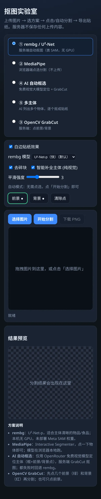
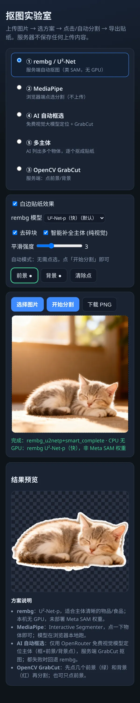
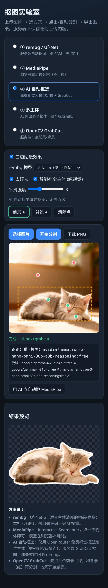
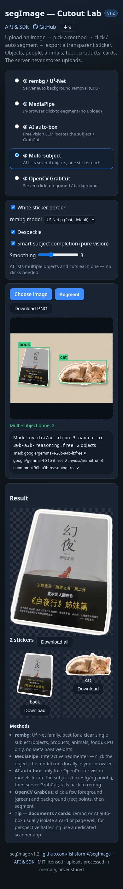

<div align="center">

[English](README.md) · **简体中文**

# ✂️ segImage

**开源抠图 / 去背景 / 贴纸生成工具：rembg、MediaPipe、OpenCV GrabCut 与免费 AI 自动框选，提供 REST API、SDK，以及一个从不保存上传内容的在线演示。**

[](CHANGELOG.md)
[](LICENSE)
[](backend/requirements.txt)
[](https://fastapi.tiangolo.com/)
[](https://jev.fishmaple.cn/segImage/?lang=zh)


</div>

## 功能

- **一个界面 5 种分割方式**：rembg（U²-Net 系列，服务端 CPU）、MediaPipe Interactive Segmenter（浏览器本地，不上传）、OpenCV GrabCut（点前景/背景）、**AI 自动框选**（免费视觉大模型找主体 → GrabCut）、**多主体**（每个物体一张贴纸，可打包 ZIP 下载）。
- **通用主体**：物品/商品、人物、动物、食物、书本、证件卡片、文档等。
- **贴纸输出**：透明 PNG，自动裁剪，可选白色描边。
- **掩码后处理**：去碎块、填洞、轮廓平滑、导向滤波羽化（`smooth` 0–10）。
- **智能补全主体（纯视觉）**：以模型掩码为种子，用边缘背景颜色模型 + 洪泛 + trimap/GrabCut + SLIC 投票把只抠出一部分的主体补全，并有防“吞背景”保护。
- **带版本的 REST API**（`/api/v1/*`）：OpenAPI / Swagger 文档、统一 JSON 错误格式，附轻量 **Python** 与 **JS/TS** SDK。
- **只用免费模型**：AI 模式只调用 id 以 `:free` 结尾的 OpenRouter 模型；未配置 Key 或全部失败时回退本地 rembg。
- **隐私**：上传只在内存中处理并立即丢弃；无数据库、不落盘。
- **中英双语界面**：默认英文，`?lang=zh` 切换中文，并记住选择。

## 在线演示

👉 **https://jev.fishmaple.cn/segImage/?lang=zh** · API 文档：[站内说明](https://jev.fishmaple.cn/segImage/api.html?lang=zh) · [Swagger UI](https://jev.fishmaple.cn/segImage/api/docs)

演示服务器为 4 核、无 GPU 的小机器，请适度使用；批量任务请自行部署。

| 桌面端 | AI 自动框选 | 多主体 |
|---|---|---|
|  |  |  |

<p>




</p>

## 快速开始

需要 Python 3.10+（已在 3.13 上验证）。首次请求会把 `u2netp` 模型（约 4.7 MB）下载到 `~/.u2net`。

```bash
git clone https://github.com/fishstormX/segImage.git
cd segImage/backend
python3 -m venv .venv && . .venv/bin/activate
pip install -r requirements.txt
uvicorn app.main:app --port 8765          # 同时提供 API 与网页
```

浏览器打开 http://127.0.0.1:8765/ （界面）和 http://127.0.0.1:8765/api/docs （Swagger）。另开终端验证：

```bash
curl -s http://127.0.0.1:8765/api/v1/health
curl -s -F file=@photo.jpg http://127.0.0.1:8765/api/v1/segment \
  | python3 -c "import sys,json,base64;d=json.load(sys.stdin);open('sticker.png','wb').write(base64.b64decode(d['image_png_b64']));print(d['engine'],d['elapsed_ms'],'ms')"
```

可选：启动前 `export OPENROUTER_API_KEY=...` 以启用 AI 模式（只用免费模型）。

## API 与 SDK

| 路由 | 说明 |
|---|---|
| `GET  /api/v1/health` | 版本、已加载模型、限制 |
| `GET  /api/v1/models` | rembg 模型 + 当前可用的免费视觉模型 |
| `POST /api/v1/segment` | 单主体 → 透明 PNG；`method` = `rembg` \| `grabcut` \| `ai` |
| `POST /api/v1/multi` | 最多 6 个主体 → 每个一张 PNG |
| `GET  /api/docs`、`/api/openapi.json` | Swagger UI / OpenAPI 3.1 |
| `POST /api/segment`、`GET /api/health` | 旧接口别名（保持 v1.0/1.1 返回格式） |

表单字段（`multipart/form-data`）：`file`（≤ 12 MB）、`method`、`rembg_model`（默认 `u2netp`，可选 `isnet-general-use` / `u2net` / `silueta`）、`complete`（true）、`smooth`（0–10，默认 3）、`despeckle`（true）、`white_border`（true）、`points_json` / `rect_json`（GrabCut 种子，坐标归一化 0..1）。

```jsonc
// 成功
{ "ok": true, "version": "1.2.0", "method": "rembg", "engine": "rembg_u2netp+smart_complete",
  "rembg_model": "u2netp", "width": 960, "height": 1280, "elapsed_ms": 1800,
  "image_png_b64": "iVBOR…", "mask_png_b64": "iVBOR…", "detection": null }
// 失败
{ "ok": false, "error": { "code": "FILE_TOO_LARGE", "message": "File larger than 12 MB" } }
```

错误码：`EMPTY_FILE`、`BAD_JSON`、`UNKNOWN_MODEL`（400）· `FILE_TOO_LARGE`（413）· `UNSUPPORTED_IMAGE`（415）· `VALIDATION_ERROR`（422）· `SEGMENTATION_FAILED`（500）。

**限制：**单次上传 ≤ 12 MB，rembg 输入缩放到长边 ≤ 1280 px。无鉴权、无 API Key，公共实例尽力而为，请控制在每分钟几次。AI 模式受免费模型限流影响（最长约 2 分钟，失败回退 rembg）。

**Python**：单文件、仅标准库（[sdk/python/segimage.py](sdk/python/segimage.py)）

```python
from segimage import SegImage
client = SegImage("https://jev.fishmaple.cn/segImage")
client.segment("photo.jpg", method="rembg").save("sticker.png")
```

**JavaScript / TypeScript**：ESM，`fetch` + `FormData`，浏览器与 Node ≥ 18 通用，自带类型（[sdk/js](sdk/js)）

```js
import { SegImage } from "./segimage.js";
const res = await new SegImage("https://jev.fishmaple.cn/segImage").segment(file, { method: "rembg" });
img.src = URL.createObjectURL(res.image);
```

更多：[sdk/curl.md](sdk/curl.md)、[sdk/python/example.py](sdk/python/example.py)、[sdk/js/example.mjs](sdk/js/example.mjs)。

## rembg 模型

模型按需加载，内存中最多同时保留 2 个（LRU）。4 vCPU / 3.6 GB / 无 GPU 实测（约 1280px）：

| 模型 | 推理耗时 | 峰值内存 | 备注 |
|---|---|---|---|
| u2netp（默认） | ~0.3 s | ~0.7 GB | 最快，物品类最干净 |
| silueta | ~0.7 s | ~0.75 GB | 截图类背景易漏抠 |
| u2net | ~0.7 s | ~1.2 GB | 复杂背景、人像更稳 |
| isnet-general-use | ~1.8 s | ~1.9 GB | 平面物体容易只留下文字 |
| birefnet-general-lite | — | >2.9 GB（OOM） | 未启用：3.6 GB 机器无法与服务共存 |

## 方案对比

以下结果均来自线上 API（4 vCPU、无 GPU；平滑 3、去碎块、白边；输入长边 ≤1280px）。MediaPipe 在无头 Chrome 中模拟一次点击。金色边框为该案例最佳结果。

### 案例 1 · 书封实拍


- **最佳：rembg U²-Net-p**，干净地拿到整本书的矩形轮廓；U²-Net / Silueta / AI 自动框选接近。
- ISNet 把“主体”理解成封面文字，只留下几个字；MediaPipe 单点无法越过黑色腰封。
- 结论：书本、卡片、包装等“平面物体 + 大块文字”，U²-Net 系列最可靠。

### 案例 2 · 逆光小猫


- **最佳：U²-Net（完整）+ 智能补全**，毛发边缘与前爪最完整；ISNet、Silueta、MediaPipe 也可用（MediaPipe 约 4 s 且不上传）。
- 失败模式：U²-Net-p + 补全多带了一条地毯；固定矩形的 GrabCut 把明亮窗户当成前景。

### 案例 3 · 全息汉服人像（发光背景）


- **最佳：U²-Net（完整）+ 智能补全**；Silueta 接近。
- 最难的一类：半透明面料与背景颜色接近。U²-Net-p + 补全把背景“补”进了主体（补全的已知失败模式），可尝试关闭补全。

## 方案选择指南

| 场景 | 推荐 | 备注 |
|---|---|---|
| 单个清晰物体 / 商品 / 宠物 / 菜品 | rembg U²-Net-p（默认）+ 智能补全 | 最快；不满意换 U²-Net 或 ISNet |
| 人物 / 人像 | rembg U²-Net 或 Silueta | 背景被补进来时关闭补全 |
| 复杂或发光背景、半透明材质 | rembg U²-Net（完整）或 Silueta | |
| 书本、证件卡片、文档、包装 | rembg U²-Net-p / U²-Net | 避免 ISNet；需要透视拉正请用扫描类 App（segImage 不做拉正） |
| 想精确指定某个物体 | MediaPipe 点选 或 GrabCut 前景/背景点 | MediaPipe 完全在浏览器运行 |
| 不确定主体 / 截图 | AI 自动框选 | 只用免费模型，常被限流，失败回退 rembg |
| 一张图多个物体分别做贴纸 | 多主体 | 物体分开摆放时效果好 |

## 配置

| 变量 | 默认 | 作用 |
|---|---|---|
| `OPENROUTER_API_KEY` | 无（可选） | 启用 AI 自动框选 / 多主体；**只会调用 `:free` 模型**；未设置时回退 rembg |
| `SEGIMAGE_BASE_PATH` | `""` | 反向代理下的 URL 前缀（如 `/segImage`），用于 Swagger |
| `SEGIMAGE_MAX_BYTES` | `12582912` | 上传上限（字节） |
| `SEGIMAGE_SERVE_UI` | `1` | 同时在 `/` 提供 `frontend/`（由 nginx 提供静态页时设为 `0`） |
| `SEGIMAGE_STATIC_DIR` | `../frontend` | 网页目录 |
| `U2NET_HOME` | `~/.u2net` | rembg 模型缓存 |

参见 [.env.example](.env.example)。不要提交真实 Key；服务器上放在 root 专属的 `EnvironmentFile`（`chmod 600`）。

## 部署

Debian + nginx + systemd（无需 Docker）：

```bash
mkdir -p /opt/segImage && cp -r backend/* /opt/segImage/
cd /opt/segImage && python3 -m venv venv && venv/bin/pip install -r requirements.txt
mkdir -p /var/cache/segImage/u2net && chown -R www-data:www-data /var/cache/segImage /opt/segImage
install -d -m 700 /etc/segImage && install -m 600 .env.example /etc/segImage/env   # 填入你的 key
cp deploy/segImage.service /etc/systemd/system/ && systemctl daemon-reload && systemctl enable --now segImage
mkdir -p /var/www/jev/segImage && cp frontend/* /var/www/jev/segImage/   # 与 deploy/nginx-segImage.conf 中的 alias 一致
# 把 deploy/nginx-segImage.conf 加入站点 server { } 块
nginx -t && systemctl reload nginx
curl -s https://<你的域名>/segImage/api/v1/health
```

暂未提供 Dockerfile（见路线图）。

## 隐私

- 上传内容读入内存、处理后在请求结束时丢弃；无数据库、不写磁盘（systemd `PrivateTmp=true`）。
- MediaPipe 模式完全在浏览器运行，图片不离开你的设备。
- AI 模式会把缩小后的图片发给 OpenRouter 免费模型（第三方），敏感图片请勿使用。
- API Key 只在服务器上，永不下发到浏览器。

## 路线图

- [ ] Dockerfile + compose
- [ ] 文档模式：稳健的四边形检测 + 透视拉正（1.2 的原型不够可靠，未发布）
- [ ] 内存允许时的可选 GPU 后端（SAM 2 / BiRefNet）
- [ ] 批量接口与限流响应头
- [ ] SDK 发布到 PyPI / npm

## 参与贡献

欢迎 Issue 与 PR，见 [CONTRIBUTING.md](CONTRIBUTING.md)。请勿在 Issue 或提交中包含 API Key、服务器地址或个人照片。

## 许可证

[MIT](LICENSE) © 2026 fishstormX

## 致谢

[rembg](https://github.com/danielgatis/rembg) · [U²-Net](https://github.com/xuebinqin/U-2-Net) · [MediaPipe](https://developers.google.com/mediapipe) · [OpenCV](https://opencv.org/) · [OpenRouter](https://openrouter.ai/) · [FastAPI](https://fastapi.tiangolo.com/) · [scikit-image](https://scikit-image.org/)
